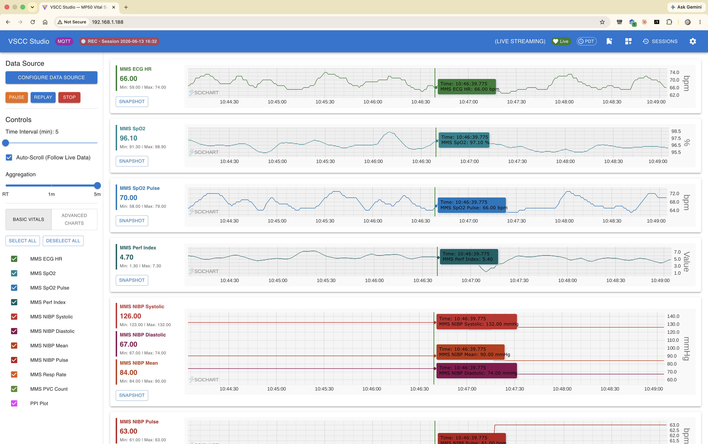
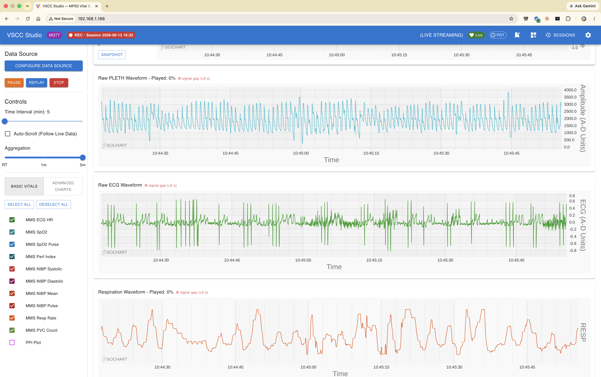

# VSCC Studio

The web frontend of **VSCC** (*VitalSignsCapture + Charts*) — live charting,
session recording, and data export for patient-monitor telemetry.

> [!WARNING]
> **Research and education use only — not a medical device.**
> This software is not cleared or approved for clinical use and must never be used
> for patient monitoring, alarming, or any clinical decision-making. A certified
> monitor remains the source of truth at all times.
>
> **Patient data stays local.** Captured telemetry may constitute Protected Health
> Information (PHI). Never publish it to brokers, dashboards, or endpoints outside
> your controlled network, and never write physiological values into logs, browser
> consoles, or third-party telemetry/analytics services. De-identify any recording
> before sharing it.

Real-time physiological telemetry dashboard for the **Philips MP50** patient monitor.
Captured waveforms and numerics (ECG, SpO₂, Pleth, Respiration, NIBP) are streamed
into a React + [SciChart.js](https://www.scichart.com/) WebGL canvas and rendered at 60 FPS.

This is the **frontend**. It pairs with the
[vscc-mqtt-server](https://github.com/chsbusch-dot/vscc-mqtt-server) backend — an
MQTT (EMQX) + TimescaleDB stack built around
[VSCapture](https://sourceforge.net/projects/vscapture/files/), the open-source
patient-monitor capture tool by John George K. The backend's installer downloads
the latest VSCapture automatically; no separate setup is needed.



---

## Features

- **Live MQTT streaming** over WebSocket (`mqtt` client) with per-channel topic mapping
- **High-frequency waveforms** — Pleth and Respiration rendered as continuous traces, plus ECG channels
- **Numeric vitals** — SpO₂, pulse rate, NIBP (systolic/diastolic/mean), respiration rate, heart rate
- **Multiple data sources** — live MQTT broker, URL polling, and local file upload / replay of recorded exports
- **Synchronized zoom & pan** across all charts (`GlobalSyncGroup`)
- **FIFO-bounded series** so long sessions don't leak memory
- **Auto-scroll / follow-live** toggle, adjustable time window, and per-channel selection

### Sessions, analysis & export
- **Session browser** — recordings are auto-grouped into sessions (named start/stop with subject
  code + notes); load any past session back into the charts, or delete it.
- **Downloads** — per-session or all-sessions ZIP (CSV + Parquet), and **EDF** export for
  EDFbrowser / MNE / biosignal toolchains, all streamed so multi-GB packages never block the browser.
- **Capture-quality view** — per-waveform loss statistics (nominal rate, expected vs actual samples,
  gaps, longest gap).
- **Event annotations** — drop timestamped markers ("intubation", "drug given") and review/delete them.
- **Capture health indicator** — a header chip polling the backend's `/api/status` (live / stalled /
  offline, last-data age, DB lag, per-source clock offset). Observability only — never a clinical alarm.
- **Settings** — data retention, **dashboard-managed capture config** (monitor IP, interval, waveset,
  scale, devid with live recycle), and a **Local / UTC** time-display toggle.

### Waveforms & numerics



> The screenshots above show SpO₂ and pulse trends, a raw plethysmograph pulse waveform, and a
> respiration trace from recorded MP50 data.

---

## Getting started

**Prerequisites:** [Bun](https://bun.sh) 1.4+.

```bash
bun install        # install dependencies
bun run dev        # Vite dev server with HMR (binds --host for LAN access)
```

The dashboard targets the backend on the host it is served from: MQTT at
`ws://<host>:8083/mqtt`, the REST API at `http://<host>:8001`, the streamer at
`<host>:8000` (override the host with `VSCC_HOST`, see `docker-entrypoint.sh`).
Served over **https**, or with `VSCC_SAME_ORIGIN=1`, it goes through the page's own
origin instead (`wss://<host>/mqtt`, `/api/...`, `/DataExportVSC.json`, `/ws/stream`),
so a reverse proxy in front of the stack must route those paths. Open
**Configure Data Source** in the sidebar to point it at your broker, switch providers
(MQTT / URL / WebSocket / File Upload), and map each waveform to its topic or file.

### Scripts

| Command | Description |
| --- | --- |
| `bun run dev` | Vite dev server with hot reload |
| `bun run build` | Type-check (`tsc -b`) + production build — **the authoritative CI gate** |
| `bun run lint` | ESLint with type-aware rules |
| `bun run test` | Vitest unit tests |
| `bun run preview` | Serve the production build locally |

---

## Data sources

| Provider | How it works |
| --- | --- |
| **MQTT Broker** | Subscribes to per-channel topics (e.g. `mp50/VitalSigns`, `mp50/HF-PLETH`) over WebSocket. High-frequency channels are buffered and flushed in batches. |
| **URL (Polling)** | Periodically fetches a JSON export (e.g. `DataExportVSC.json`) over HTTP. |
| **WebSocket** | Direct WS stream (reserved/experimental). |
| **File Upload** | Replays recorded exports — JSON numerics and chunk-streamed `*WaveExport.csv` waveform files — entirely in the browser. |

Each channel is mapped independently, so you can mix sources (e.g. live MQTT vitals while replaying a recorded waveform).

---

## Architecture

| File | Responsibility |
| --- | --- |
| `src/data/DashboardContext.tsx` | Central state (`useReducer` + Context); default endpoints, channel mappings, toggles |
| `src/data/constants.ts` | `PHYSIO_META` — metadata (label, unit, group, color) for every physiological ID |
| `src/components/Sidebar.tsx` | Data-source controls, channel selection, MQTT/upload connection lifecycle |
| `src/components/DataSourceModal.tsx` | Provider + per-channel topic/file mapping UI |
| `src/components/AppLayout.tsx` | Layout, chart grouping, header (health chip, time-zone chip, Mark-event, Sessions, Settings) |
| `src/components/ChartContainer.tsx` | Primary waveform rendering (gold-standard SciChart lifecycle) |
| `src/components/AdvancedCharts.tsx` | Raw Pleth / Respiration waveform charts |
| `src/hooks/useSciChart.ts` | SciChart surface lifecycle hook |
| `src/utils/dataParser.ts` | JSON export → `TelemetryRecord[]` parsing |
| `src/components/SessionsDrawer.tsx` | Session browser — load / download / quality / delete, signals legend |
| `src/components/SettingsDialog.tsx` | Retention, capture config, Local/UTC time toggle |
| `src/components/SessionQualityDialog.tsx` | Per-waveform loss statistics + EDF download |
| `src/components/AnnotationsDialog.tsx` | Add / list / delete event markers |
| `src/components/HealthIndicator.tsx` | Capture-health header chip (polls `/api/status`) |
| `src/data/sessionsApi.ts` | Typed REST client for sessions, quality, annotations, status, capture-config |
| `src/addons/` | Add-on panel hook: build-time entry point, live waveform tap, panel slot (see below) |

**Stack:** React 19 · TypeScript 5.9 · Vite 7 · SciChart.js 5 · MUI 7 · mqtt.js 5.

---

## Add-on panels

Core charts community (MMS) signals only. A separate build can add its own panels for other
waveform ids, and its own series to the core charts, without patching this repo, through one
build-time entry point. Core still renders nothing for panel ids it has no series for.

**Entry point.** `src/addons/index.ts` imports the module `vscc-addons`. By default that
resolves to `src/addons/none.ts`, which registers nothing, so the public build is unchanged.
To inject a module, set `VSCC_ADDONS` (absolute path, or relative to the working directory)
for the build or dev server:

```bash
VSCC_ADDONS=/abs/path/to/addons.tsx bun run build
```

The module default-exports `DashboardAddons` (types in `src/addons/types.ts`):

```ts
interface DashboardAddons {
  topics?: readonly string[];      // extra live MQTT topics, subscribed on connect
  waveTopics?: Readonly<Record<string, readonly string[]>>;  // topic -> `signals` ids core charts from it
  panels?: readonly AddonPanel[];  // mounted under the core charts, in this order
  signals?: Readonly<Record<string, SignalMeta>>;  // extra series, keyed by physio_id
}
interface SignalMeta { name: string; unit: string; group: string; color: string }
interface AddonPanel { id: string; component: ComponentType<AddonPanelProps> }
interface AddonPanelProps { subscribeWaveform: SubscribeWaveform }
type SubscribeWaveform =
  (ids: readonly string[], listener: (frame: WaveformFrame) => void) => () => void;
interface WaveformFrame { topic: string; samples: WaveformSample[] }
// WaveformSample = { time: number; physio_id: string; value: number | null; device_id?: string }
```

**Data.** A panel calls `subscribeWaveform(ids, listener)`, typically in a `useEffect` that
returns the unsubscribe function. The listener gets one frame per live MQTT message that
carries a requested `physio_id`: the message's samples for those ids, in arrival order, with
timestamps as received. Nothing is resampled or merged. Frames flow while live view plays
and stop while it is paused. The tap runs before core's topic mapping, and core's filtering
is unchanged: core drops samples on topics it has no mapping for, as before.

**Render.** `AddonPanels` mounts each panel in a `data-addon-panel="<id>"` box below the core
charts. With no panels registered it renders nothing.

**Series.** `signals` registers extra series for core's own charts. `src/data/signalMeta.ts`
merges them with `PHYSIO_META` in one lookup (`signalMeta(id)`, `SERIES_IDS`) that the live
series menu, the chart grouping, the chart titles, units, tooltips and colours, and the session
legend all read. Registered series follow the core ones in the menu, in insertion order, and
`isCommunitySignal` accepts them, so the session legend lists them. A core id keeps its core
metadata: an add-on cannot rename or recolour an MMS series. A series charts live when its
samples arrive on a topic core maps (e.g. `mp50/VitalSigns`) or on one of the add-on's
`waveTopics`. Without add-ons the menu is exactly `PHYSIO_META`.

**Wave topics.** `waveTopics` maps an add-on topic to the `signals` ids core charts from it.
Core subscribes those topics on connect and feeds the listed ids into the same buffer as its
own HF waves: a message may carry one sample or an array, timestamps stay as received, and the
buffer flushes into the live store every 100 ms while live view plays. Selected in the series
menu, such an id charts like any registered series. Other ids on the topic, listed ids missing
from `signals`, and every topic not listed in `waveTopics` still reach only the panels. A topic
core maps itself keeps its core mapping. Replay needs nothing extra: it charts whatever a stored
session returns for a registered id.

Notes for add-on authors:

- List only topics core does not subscribe itself (`mp50/VitalSigns`, `mp50/HF-ECG`,
  `mp50/HF-PLETH`, `mp50/HF-RESP` by default), and no wildcard that overlaps them. Core's
  topics reach the tap anyway, and an overlapping subscription can make the broker deliver a
  message twice, which core would then chart twice.
- With `VSCC_ADDONS` set, the build dedupes React, React DOM, MUI and Emotion so the module
  shares this build's copies, and the dev server may read the module's directory. For type
  checking in the consuming repo, map `vscc-addons` in its own tsconfig and import the types
  from this repo's `src/addons/types.ts`.
- A panel that throws while rendering takes the page down with it; a listener that throws is
  caught and logged.

---

## ⚠️ The imperative chart boundary

`ChartContainer.tsx`, `AdvancedCharts.tsx`, and `useSciChart.ts` form an **imperative WebGL boundary**
and are intentionally exempt from some React/ESLint rules. When working in these files:

- **Do not** put chart data in `useState` or add chart variables to `useEffect` dependency arrays.
- **Do not** remove the intentional ESLint overrides (`react-hooks/exhaustive-deps`, `react-hooks/purity`,
  `@typescript-eslint/no-floating-promises`) — they protect the chart lifecycle.
- **Do not** enable React `StrictMode` — SciChart WebGL contexts are limited (~8–16 per browser) and
  double-mounting destroys the app.
- **Do** use `appendRange()` for streaming, set `fifoCapacity` on real-time series, and normalize the
  X-axis to Unix epoch **seconds** (`Date.getTime() / 1000`).

---

## SciChart license

SciChart Community Edition expires every **6 months** and charts will show a license error after expiry. Refresh with:

```bash
bun add scichart@latest
```

---

## ⚖️ HIPAA Compliance Disclaimer

This system processes medical telemetry that may contain **electronic Protected Health Information (ePHI)**.

**This software does not contain any controls to support HIPAA compliance** — it provides no authentication, access control, audit logging, or encryption (in transit or at rest). Running it does **not** make a deployment HIPAA-compliant. Operators are solely responsible for:
* Secure infrastructure — encryption in transit and at rest, network isolation, access control, and audit logging.
* Disabling verbose console logging (`console.log`) in production so raw physiological payloads are never leaked.
* Executing their own Business Associate Agreements (BAAs) with hosting providers.

Research and education use only — not a medical device.
